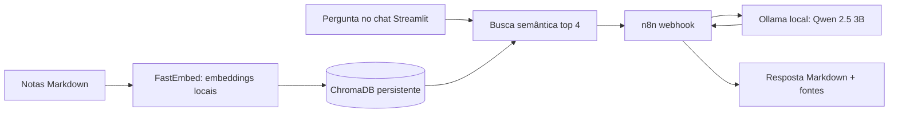

# 🧠 Anti-Copilot — Fio

> Chatbot de memória de projeto que utiliza RAG (Retrieval-Augmented Generation) para recuperar documentação, decisões e orientações relevantes, ajudando pessoas desenvolvedoras a reencontrar o contexto de seus projetos.

---

## 📋 Sobre o Projeto

O **Anti-Copilot** é o nome do projeto, enquanto **Fio** é o chatbot de memória de projeto. Sua proposta é facilitar a recuperação de informações técnicas, documentação e decisões importantes, evitando que o conhecimento acumulado durante o desenvolvimento fique perdido em conversas, arquivos ou anotações.

O MVP utiliza um pequeno acervo local baseado em páginas da documentação oficial do [FastAPI](https://fastapi.tiangolo.com/), um projeto conhecido por seus tutoriais organizados por assunto.

As notas armazenadas localmente são resumos em português acompanhados de links para as páginas originais, não representando uma cópia integral da documentação. O FastAPI informa que o projeto utiliza licença MIT em seu [repositório oficial](https://github.com/fastapi/fastapi).

O sistema utiliza uma arquitetura RAG para transformar documentos em vetores, armazená-los em um banco vetorial e recuperar os trechos mais relevantes de acordo com cada pergunta.

---

## 🏗️ Arquitetura e Fluxo RAG



O processamento acontece em etapas:

1. **Preparação dos documentos:** os arquivos Markdown são utilizados como base de conhecimento.
2. **Geração de embeddings:** o FastEmbed transforma cada seção dos documentos em vetores numéricos.
3. **Armazenamento:** o ChromaDB persiste os vetores localmente.
4. **Recuperação:** a cada pergunta, o sistema realiza uma busca semântica e recupera os quatro trechos mais próximos.
5. **Orquestração:** a pergunta, as evidências e as fontes são enviadas ao webhook do n8n.
6. **Geração da resposta:** o workflow encaminha o contexto ao Ollama, que utiliza o modelo Qwen 2.5 3B.
7. **Exibição:** o chatbot apresenta a resposta em Markdown e os trechos recuperados, permitindo visualizar as fontes utilizadas pelo RAG.

---

## 📁 Estrutura do Projeto

```text
Anti-Copilot/
├── .openidea/
├── .venv/
├── data/
├── src/
│   └── anti_copilot/
│       ├── application/
│       │   ├── __init__.py
│       │   ├── mentor.py
│       │   └── ports.py
│       ├── infrastructure/
│       │   ├── __init__.py
│       │   ├── chroma_fastembed.py
│       │   └── n8n_client.py
│       ├── presentation/
│       │   ├── __init__.py
│       │   └── streamlit_app.py
│       ├── __init__.py
│       └── config.py
├── workflows/
├── .gitignore
├── .python-version
├── app.py
├── compose.yaml
├── pyproject.toml
├── README.md
├── seed.py
└── uv.lock
```

A aplicação segue uma arquitetura organizada em camadas, com responsabilidades separadas:

- **Application:** concentra os casos de uso e contratos da aplicação.
- **Infrastructure:** implementa os componentes de infraestrutura, como ChromaDB, FastEmbed e cliente n8n.
- **Presentation:** concentra a interface de interação com o usuário, desenvolvida com Streamlit.

As dependências seguem de fora para dentro: a camada de apresentação monta as implementações concretas, enquanto `application/mentor.py` conhece apenas os contratos definidos em `application/ports.py`.

---

## 🧩 Módulos e Responsabilidades

| Módulo | Responsabilidade | Descrição |
|---|---|---|
| **Application** | Casos de uso e contratos | Define a lógica principal e as interfaces utilizadas pela aplicação. |
| **Infrastructure** | Persistência e integrações | Implementa o ChromaDB, FastEmbed e a comunicação com o n8n. |
| **Presentation** | Interface Streamlit | Disponibiliza o chat e apresenta respostas e fontes recuperadas. |
| **Knowledge Base** | Base de conhecimento | Armazena os documentos Markdown utilizados pelo sistema. |
| **Workflows** | Orquestração | Contém o workflow n8n responsável pelo fluxo de geração das respostas. |

---

## 🛠️ Tecnologias


| Tecnologia | Finalidade |
|---|---|
| **Python** | Linguagem principal da aplicação. |
| **Streamlit** | Desenvolvimento da interface web e do chat local. |
| **FastEmbed** | Geração local de embeddings multilíngues. |
| **ChromaDB** | Armazenamento persistente e busca vetorial por distância cosseno. |
| **n8n** | Orquestração do fluxo de processamento e geração de respostas. |
| **Ollama** | Execução local de modelos de linguagem. |
| **Qwen 2.5 3B** | Modelo de linguagem utilizado na geração das respostas. |

---

## ⚙️ Requisitos Locais

Para executar o projeto, é necessário ter:

- Python **3.11 ou superior**.
- [uv](https://docs.astral.sh/uv/) para gerenciamento do ambiente e das dependências Python.
- Docker com Docker Compose.
- Aproximadamente **8 GB de espaço livre** para imagens, dependências e modelos durante a primeira instalação.

Os modelos utilizados possuem aproximadamente:

- **Qwen 2.5 3B:** 1,9 GB.
- **Modelo de embeddings:** 220 MB.

Após os downloads iniciais, a aplicação funciona localmente e não necessita de acesso à internet para responder perguntas sobre o acervo instalado.

---

## 🚀 Como Executar

### Pré-requisitos

Certifique-se de que Python, uv e Docker com Docker Compose estejam instalados e funcionando corretamente.

### 1. Iniciar n8n e Ollama

Na raiz do projeto, execute:

```bash
docker compose up -d
```

Em seguida, baixe o modelo de linguagem:

```bash
docker compose exec ollama ollama pull qwen2.5:3b
```

### 2. Instalar as dependências Python

Na raiz do projeto, execute:

```bash
uv sync
```

### 3. Configurar o workflow no n8n

Na primeira execução, importe o workflow utilizando:

```bash
docker compose exec -T n8n n8n import:workflow --input=/opt/anti-copilot/workflows/anti_copilot_chat.json
```

Depois, abra [http://localhost:5678](http://localhost:5678), localize o workflow **Anti-Copilot local RAG chat** e clique em **Publish**.

O n8n gera o ID local do workflow. O arquivo também pode ser importado diretamente pela interface.

O procedimento detalhado está disponível em [`docs/CONFIGURAR_N8N.md`](docs/CONFIGURAR_N8N.md).

### 4. Criar os embeddings e o banco local

Execute:

```bash
uv run python seed.py
```

Na primeira execução, o FastEmbed realiza o download do modelo multilíngue de embeddings.

### 5. Iniciar a aplicação

Execute:

```bash
uv run streamlit run app.py --server.address 127.0.0.1
```

A interface ficará disponível em:

**http://localhost:8501**

---

## 💬 Perguntas para Demonstrar

O chatbot pode ser utilizado para recuperar informações técnicas da documentação armazenada na base de conhecimento.

Algumas perguntas para demonstrar o funcionamento:

- "Como declaro um parâmetro de caminho inteiro e o que acontece com um valor inválido?"
- "Como o FastAPI interpreta ao mesmo tempo caminho, query e corpo?"
- "Quando devo usar `async def` e o que pode bloquear a aplicação?"
- "Como o sistema de dependências ajuda a validar um usuário?"

### Visualização das fontes

Abaixo de cada resposta, abra a seção **Fontes recuperadas do ChromaDB**.

Nela, é possível visualizar:

- Os trechos de documentação recuperados.
- As distâncias vetoriais dos resultados.
- Os links para as fontes oficiais.

Esse recurso permite acompanhar quais informações foram utilizadas na construção da resposta e torna o funcionamento do RAG mais transparente.

---

## 🗃️ Base de Conhecimento

A base de conhecimento é composta por arquivos Markdown armazenados localmente no diretório:

```text
data/knowledge/
```

Para adicionar novos materiais, basta colocar arquivos `.md` nesse diretório e executar novamente:

```bash
uv run python seed.py
```

O comando reconstrói apenas a coleção `anti_copilot_project_memory` no ChromaDB.

### Metadados dos documentos

É possível utilizar metadados opcionais no início dos arquivos Markdown para identificar a origem dos materiais:

```toml
+++
title = "Título do material"
source_url = "https://endereco-da-fonte"
organization = "Autor ou organização"
+++
```

Depois do cabeçalho, o conteúdo pode ser escrito normalmente em Markdown.

### Organização dos documentos

Para melhorar a recuperação semântica:

- Utilize títulos `##` para dividir materiais em seções.
- Prefira conteúdos organizados por assunto.
- Informe os links das fontes originais quando disponíveis.
- Evite concentrar assuntos diferentes em uma única seção muito extensa.

O processo de indexação cria trechos menores para facilitar a busca semântica e a recuperação de informações relevantes.

---

## 📚 Documentação

A documentação complementar do projeto está organizada no diretório `docs/`.

| Arquivo | Descrição |
|---|---|
| [`docs/CONFIGURAR_N8N.md`](docs/CONFIGURAR_N8N.md) | Orientações para importar e configurar o workflow no n8n. |
| [`docs/ARQUITETURA.md`](docs/ARQUITETURA.md) | Explicação da arquitetura e das responsabilidades de cada módulo. |

---

## 🎯 Objetivo do Projeto

O **Anti-Copilot — Fio** busca demonstrar como técnicas de RAG, embeddings locais, bancos vetoriais e modelos de linguagem podem ser combinados para construir um assistente capaz de recuperar conhecimento técnico de forma contextualizada.

A proposta é oferecer uma ferramenta de memória de projeto que facilite o acesso a informações já documentadas, reduza a necessidade de procurar novamente conteúdos técnicos e ajude pessoas desenvolvedoras a manter a continuidade do conhecimento durante o desenvolvimento de software.

## 🎬 Demonstração

Link do video de demonstração do projeto: https://drive.google.com/file/d/1s-GA-WIpwPxv3dVrMpe-OkdekKpIc3xI/view?usp=sharing 
