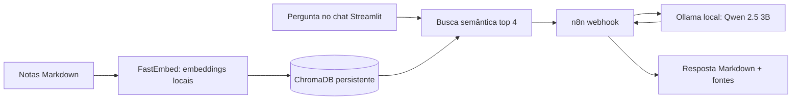

# Anti-Copilot

**Anti-Copilot** é o nome do projeto. **Fio** é o chatbot de memória de projeto: ele recupera documentação, decisões e orientações relevantes para ajudar uma pessoa desenvolvedora a reencontrar o contexto de um projeto.

O MVP vem com um pequeno acervo local baseado em páginas da documentação oficial do [FastAPI](https://fastapi.tiangolo.com/), um projeto conhecido com tutoriais organizados por assunto. As notas locais são resumos em português com links para as páginas originais; não são uma cópia integral da documentação. O FastAPI informa que o projeto usa licença MIT no [repositório oficial](https://github.com/fastapi/fastapi).

## O fluxo RAG



FastEmbed transforma cada seção Markdown em vetor numérico. O ChromaDB persiste os vetores no computador. A cada pergunta, o sistema recupera os quatro trechos mais próximos e envia pergunta, evidências e fontes ao webhook n8n. O workflow encaminha esse contexto ao Ollama. O chatbot mostra a orientação e os trechos recuperados para deixar o uso do RAG visível.

## Organização do código

```text
Anti-Copilot/
├── app.py                 # entrada da interface
├── seed.py                # entrada para indexar documentos
├── src/anti_copilot/
│   ├── application/       # caso de uso e contratos
│   ├── infrastructure/   # ChromaDB, FastEmbed e cliente n8n
│   └── presentation/     # interface Streamlit
├── data/knowledge/        # acervo Markdown
├── docs/                  # guias do projeto
└── workflows/             # workflow n8n importável
```

As dependências seguem de fora para dentro: a apresentação monta as implementações concretas, enquanto `application/mentor.py` conhece apenas os contratos em `application/ports.py`.

## Tecnologias

- Python e Streamlit: aplicação e chat local.
- FastEmbed: geração local de embeddings multilíngues.
- ChromaDB: armazenamento persistente e busca vetorial por distância cosseno.
- n8n: orquestração prática do fluxo de resposta.
- Ollama com Qwen 2.5 3B: geração local, sem chave de API.

## Requisitos locais

- Python 3.11 ou superior.
- [uv](https://docs.astral.sh/uv/) para o ambiente Python.
- Docker com Docker Compose.
- Aproximadamente 8 GB livres para imagens, dependências e modelos na primeira instalação. O modelo de chat tem cerca de 1,9 GB e o de embeddings cerca de 220 MB.

Depois dos downloads iniciais, a aplicação roda localmente e não precisa de acesso à internet para responder às perguntas sobre o acervo instalado.

## Executar

1. Inicie n8n e Ollama:

   ```bash
   docker compose up -d
   docker compose exec ollama ollama pull qwen2.5:3b
   ```

2. Instale as dependências Python:

   ```bash
   uv sync
   ```

3. Na primeira execução, importe o workflow no n8n:

   ```bash
   docker compose exec -T n8n n8n import:workflow --input=/opt/anti-copilot/workflows/anti_copilot_chat.json
   ```

   Depois, abra [http://localhost:5678](http://localhost:5678), localize **Anti-Copilot local RAG chat** e clique em **Publish**. O n8n gera o ID local do workflow. O arquivo também pode ser importado pela interface. O guia está em [`docs/CONFIGURAR_N8N.md`](docs/CONFIGURAR_N8N.md).
4. Crie os embeddings e o banco local:

   ```bash
   uv run python seed.py
   ```

   Na primeira execução, FastEmbed baixa o modelo multilíngue de embeddings.
5. Abra a interface:

   ```bash
   uv run streamlit run app.py --server.address 127.0.0.1
   ```

   O Streamlit fica em [http://localhost:8501](http://localhost:8501).

## Perguntas para demonstrar

- “Como declaro um parâmetro de caminho inteiro e o que acontece com um valor inválido?”
- “Como o FastAPI interpreta ao mesmo tempo caminho, query e corpo?”
- “Quando devo usar `async def` e o que pode bloquear a aplicação?”
- “Como o sistema de dependências ajuda a validar um usuário?”

Abra **Fontes recuperadas do ChromaDB** abaixo de cada resposta para ver os trechos, as distâncias vetoriais e os links oficiais.

## Adicionar materiais à base

Coloque arquivos `.md` dentro de `data/knowledge/` e rode `uv run python seed.py` novamente. O comando reconstrói apenas a coleção `anti_copilot_project_memory`.

Use estes metadados opcionais no começo do arquivo para que o chatbot apresente a fonte:

```toml
+++
title = "Título do material"
source_url = "https://endereco-da-fonte"
organization = "Autor ou organização"
+++
```

Depois do cabeçalho, escreva o conteúdo em Markdown. Divida materiais longos por títulos `##`; o seed cria trechos menores para busca semântica. A arquitetura e as responsabilidades de cada módulo estão explicadas em [`docs/ARQUITETURA.md`](docs/ARQUITETURA.md).
